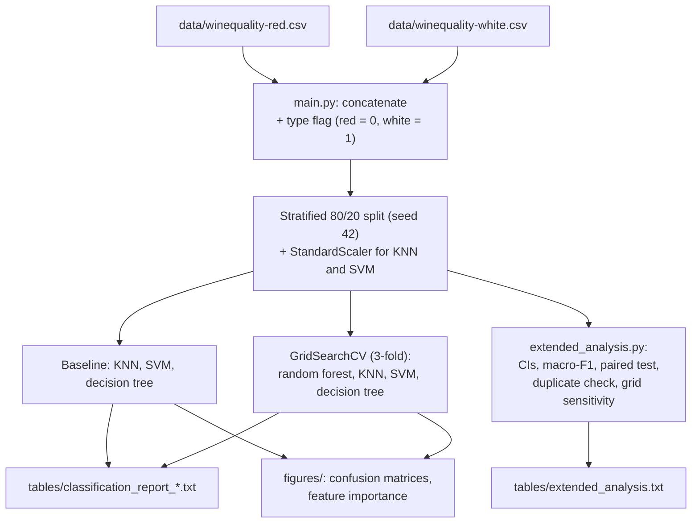

<p align="center">
  
</p>

<p align="center">
  
  
  
  
</p>

Multiclass classification of wine quality (scores 3 to 9) from 11 physicochemical measurements plus the wine type, using the combined red and white Vinho Verde datasets (6,497 wines). K-Nearest Neighbors, SVM, decision tree and random forest are compared with default settings and after grid-search tuning, evaluated on a held-out test set with accuracy, macro-F1 and confidence intervals.

| | |
|---|---|
| **Context** |  Data Mining and Machine Learning · Classification Project · Group of 4 |
| **Period** | Spring 2026 |
| **Data** | [UCI Wine Quality](https://archive.ics.uci.edu/dataset/186/wine+quality) (Cortez et al., 2009): 1,599 red + 4,898 white wines |
| **Tech** | Python, scikit-learn, pandas, matplotlib, seaborn |

📖 **[Full results, discussion and caveats → documentation.md](documentation.md)**

## Results at a glance

<p align="center">
  
  
</p>

The tuned random forest is the best model with 69.2% test accuracy (95% CI 66.6% to 71.6%) and a macro-F1 of 0.39, ahead of the tuned KNN (67.0%). All models fail on the rare qualities 3 and 9 and rarely catch quality 4. About 27% of the test wines have an exact copy in the training set, and the tree-based models and the tuned KNN get all of these right. On wines not seen in training, the random forest reaches 57.5%, only slightly above the SVM (55.7%), so part of the lead over the SVM comes from duplicates in the data and not only from better generalisation.

| Model | Accuracy | Macro-F1 |
|---|---|---|
| KNN (k = 5) | 0.559 | 0.281 |
| SVM (RBF) | 0.572 | 0.235 |
| Decision tree | 0.595 | 0.329 |
| Tuned KNN | 0.670 | 0.389 |
| Tuned SVM | 0.585 | 0.292 |
| Tuned decision tree | 0.595 | 0.329 |
| **Tuned random forest** | **0.692** | **0.393** |

## Architecture



## Project structure

```text
wine-quality-classification/
├── main.py                  # data prep, 7 models, classification reports and plots
├── extended_analysis.py     # confidence intervals, macro-F1, McNemar test, duplicate check
├── requirements.txt
├── documentation.md         # results, discussion and caveats in detail
├── data/
│   ├── winequality-red.csv
│   └── winequality-white.csv
├── figures/                 # confusion matrices (plot_02 - 08) and feature importance (plot_01)
├── tables/                  # classification reports and extended_analysis.txt
└── assets/
    └── brand-banner.svg
```

## Outputs

- `tables/classification_report_*.txt` — accuracy and per-class precision, recall and F1 for each of the 7 models
- `figures/plot_01_feature_importance_decision_tree.png` — feature importances of the decision tree
- `figures/plot_02 … plot_08_confusion_matrix_*.png` — confusion matrix for each model
- `tables/extended_analysis.txt` — accuracy with 95% confidence intervals, macro-F1, best hyperparameters, paired test, duplicate check and grid sensitivity

## Running it

```bash
python -m venv .venv
source .venv/bin/activate          # Windows: .venv\Scripts\activate
pip install -r requirements.txt
python main.py                     # about 40 s, writes figures/ and tables/
python extended_analysis.py        # about 1 min, writes tables/extended_analysis.txt
```

Requires `numpy`, `pandas`, `scipy`, `scikit-learn`, `matplotlib`, `seaborn`. Paths are resolved relative to the scripts, so they run from a clone in any location. Seeds are fixed (`42`), and the reports reproduce exactly with the tested versions.

## Methodology

All models are trained on the same stratified 80/20 split (5,197 training and 1,300 test wines) and scored on the test set. KNN and SVM use standardised features, and the tree-based models use the raw features. Hyperparameters are chosen by 3-fold cross-validated grid search on the training set only. Because the classes are very unbalanced (the test set has 6 wines of quality 3 and 1 of quality 9), the evaluation reports macro-F1 next to accuracy, and `extended_analysis.py` adds Wilson confidence intervals, an exact McNemar test for paired comparisons and a check of how many test wines also appear in the training data.

## What I learned

- A single accuracy number on a 1,300-wine test set has a margin of about ±2.5 percentage points, so models only a few points apart cannot be ranked with confidence.
- Duplicate rows can inflate the scores of memorising models such as unpruned trees, random forests and distance-weighted KNN, so it pays to check for them before comparing models.
- Hyperparameter tuning helped KNN by about 11 percentage points, barely helped the SVM (+1) and not at all for the decision tree, where the grid search picked the default settings. The random forest was only run tuned, so its gain from tuning is unknown.

## Dataset and reference

P. Cortez, A. Cerdeira, F. Almeida, T. Matos and J. Reis, "Modeling wine preferences by data mining from physicochemical properties", *Decision Support Systems* 47(4), 2009 (source of the Wine Quality datasets).
