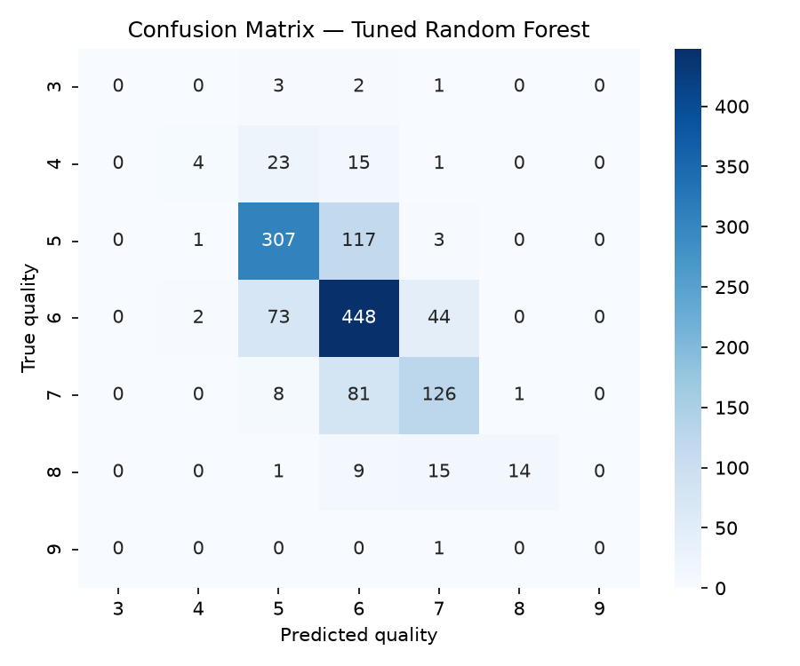
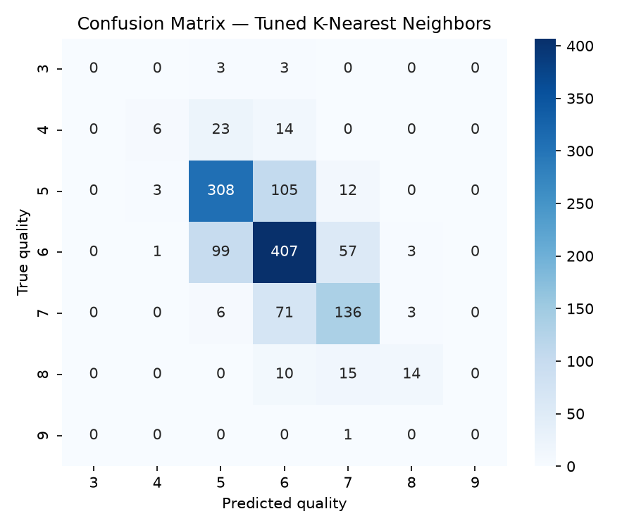
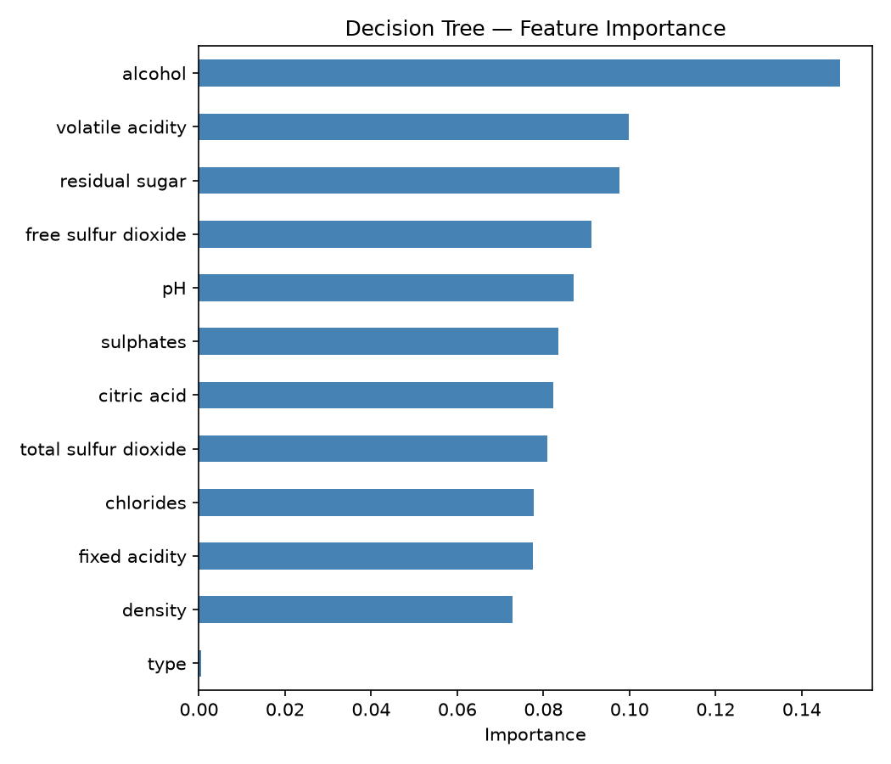
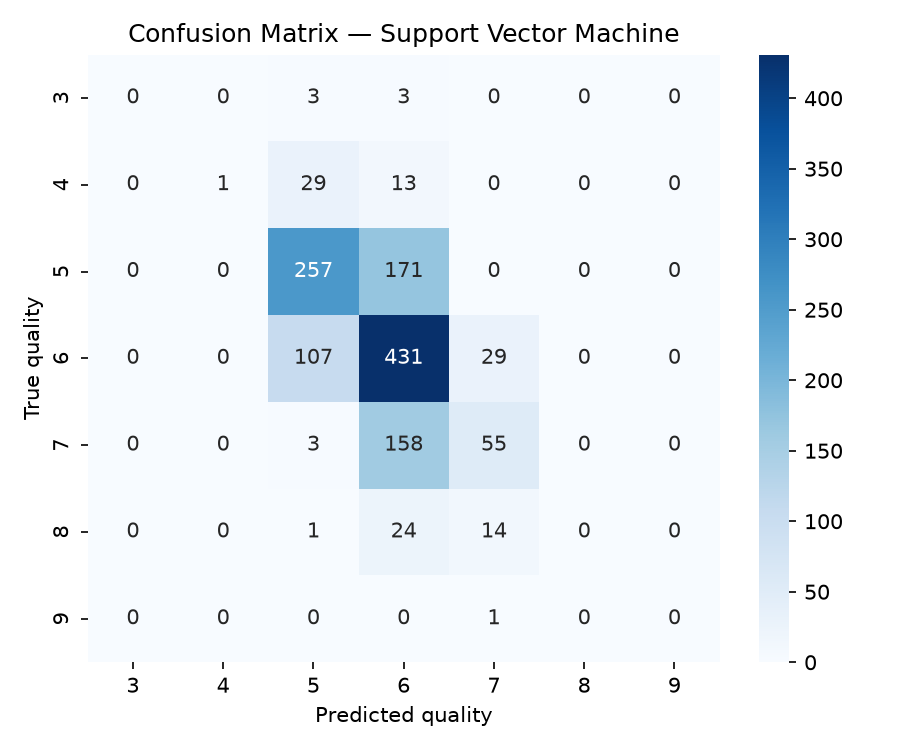

# Documentation: Wine quality classification

This document describes the data, the experimental setup, the full results and a discussion of what they do and do not show. The [README](README.md) gives the short version.

## Contents

1. [Data](#1-data)
2. [Setup](#2-setup)
3. [Results](#3-results)
4. [Per-class behaviour](#4-per-class-behaviour)
5. [Duplicates between training and test data](#5-duplicates-between-training-and-test-data)
6. [Discussion](#6-discussion)
7. [Caveats](#7-caveats)
8. [Implementation notes](#8-implementation-notes)

## 1. Data

The red and white Vinho Verde wine datasets from the UCI Wine Quality collection (Cortez et al., 2009) are combined into one problem. Each wine has 11 physicochemical measurements (fixed acidity, volatile acidity, citric acid, residual sugar, chlorides, free and total sulfur dioxide, density, pH, sulphates, alcohol), and a binary `type` column (red = 0, white = 1) is added, giving 12 features. The target is the quality score from sensory evaluation, an integer from 3 to 9.

| Quality | 3 | 4 | 5 | 6 | 7 | 8 | 9 | Total |
|---|---|---|---|---|---|---|---|---|
| Wines | 30 | 216 | 2,138 | 2,836 | 1,079 | 193 | 5 | 6,497 |
| Share | 0.5% | 3.3% | 32.9% | 43.6% | 16.6% | 3.0% | 0.1% | 100% |

Qualities 5 and 6 make up 76.5% of the data, while 3 and 9 are extremely rare. The data also contain 1,177 exact duplicate rows (see [section 5](#5-duplicates-between-training-and-test-data)).

## 2. Setup

- **Split:** stratified 80/20 split with seed 42, giving 5,197 training and 1,300 test wines. The test set contains 6, 43, 428, 567, 216, 39 and 1 wines of quality 3 to 9.
- **Scaling:** `StandardScaler`, fitted on the training set, for KNN and SVM. The decision tree and random forest use the raw features.
- **Baselines:** KNN with k = 5, SVM with RBF kernel and default parameters, decision tree with default parameters.
- **Tuning:** `GridSearchCV` with 3-fold cross-validation on the training set, scored by accuracy:

| Model | Grid | Best setting |
|---|---|---|
| Random forest | `n_estimators` {100, 200} × `max_depth` {None, 10, 20} | 100 trees, no depth limit |
| KNN | `n_neighbors` {3, 5, 7, 9} × `weights` {uniform, distance} | k = 9, distance weighting |
| SVM | `C` {0.1, 1, 10} × `gamma` {scale, auto} | C = 10, gamma = auto |
| Decision tree | `max_depth` {5, 10, 20, None} × `min_samples_leaf` {1, 5, 10} | no depth limit, leaf size 1 |

The tuned decision tree ends up with the default settings, so its results are identical to the baseline.

## 3. Results

Test-set results (n = 1,300). The 95% confidence interval for accuracy is a Wilson interval.

| Model | Accuracy | 95% CI | Macro-F1 |
|---|---|---|---|
| KNN (k = 5) | 0.5585 | [0.531, 0.585] | 0.281 |
| SVM (RBF) | 0.5723 | [0.545, 0.599] | 0.235 |
| Decision tree | 0.5954 | [0.568, 0.622] | 0.329 |
| Tuned KNN | 0.6700 | [0.644, 0.695] | 0.389 |
| Tuned SVM | 0.5854 | [0.558, 0.612] | 0.292 |
| Tuned decision tree | 0.5954 | [0.568, 0.622] | 0.329 |
| **Tuned random forest** | **0.6915** | **[0.666, 0.716]** | **0.393** |

Per-class precision, recall and F1 for every model are in `tables/classification_report_*.txt`, and `tables/extended_analysis.txt` has the numbers on this page.

**Paired comparisons (exact McNemar test on the 1,300 test wines):**

| Comparison | Only first correct | Only second correct | p-value |
|---|---|---|---|
| Tuned random forest vs. tuned KNN | 125 | 97 | 0.070 |
| Tuned KNN vs. tuned SVM | 230 | 120 | < 0.001 |
| Tuned random forest vs. decision tree | 225 | 100 | < 0.001 |

The random forest is not significantly better than the tuned KNN at the 5% level, while both are clearly better than the tuned SVM and the single decision tree.

  
  

## 4. Per-class behaviour

- **Qualities 5, 6 and 7** are predicted reasonably well. The tuned random forest reaches F1 scores of 0.73, 0.72 and 0.62.
- **Quality 8** is found by the tuned models with high precision but low recall (random forest: precision 0.93, recall 0.36).
- **Quality 4** has very low recall for all models (0.09 for the random forest, 0.14 for the tuned KNN and SVM).
- **Qualities 3 and 9** are never predicted correctly by any model. With only 6 and 1 test wines, a single wine changes these class scores by a large amount, so they say little beyond "the models do not find these classes".
- Without tuning, the SVM puts almost all wines into classes 5 and 6, which explains its low macro-F1 of 0.235 despite a mid-range accuracy.
- In the decision tree, alcohol has the highest importance, followed by volatile acidity and residual sugar. The wine `type` has almost none.

  
  

## 5. Duplicates between training and test data

1,177 of the 6,497 rows are exact duplicates of another row. After the random split, 357 of the 1,300 test wines (27.5%) have an identical feature vector in the training set. `extended_analysis.py` splits the test accuracy by this property:

| Model | Accuracy on wines also in training | Accuracy on wines not in training |
|---|---|---|
| Decision tree (baseline and tuned) | 1.000 | 0.442 |
| Tuned random forest | 1.000 | 0.575 |
| Tuned KNN | 1.000 | 0.545 |
| Tuned SVM | 0.661 | 0.557 |
| SVM (baseline) | 0.597 | 0.563 |
| KNN (k = 5) | 0.714 | 0.499 |

Models that can memorise their training data (a fully grown tree, a random forest, KNN with distance weighting) get every duplicated wine right. On wines the models have not seen, the picture is different: the random forest (57.5%) is only slightly ahead of the SVM (55.7% tuned, 56.3% baseline), and the decision tree falls to 44.2%, below all other models. The duplicated wines are also not guaranteed to have been rated independently, so the headline accuracies of the tree-based models and the tuned KNN overstate how well they predict new wines.

## 6. Discussion

**Which algorithm suits this dataset best?** Judged on the test accuracy, the tuned random forest, followed by the tuned KNN. Judged on wines that are new to the model, the gap to the SVM shrinks to about 2 percentage points, and the three best models are close together.

**Which algorithm is the most sensitive to its parameters?** Spread of the mean cross-validated accuracy over each model's grid:

| Model | Lowest | Highest | Range | Settings |
|---|---|---|---|---|
| KNN | 0.536 | 0.627 | 0.091 | 8 |
| SVM | 0.537 | 0.585 | 0.049 | 6 |
| Decision tree | 0.523 | 0.563 | 0.040 | 12 |
| Random forest | 0.618 | 0.654 | 0.036 | 6 |

KNN reacts most strongly to its parameters (number of neighbours and weighting), and the random forest is the most robust. The grids differ in size and in which parameters they vary, so these ranges are indicative and not a strict ranking.

**Is there an overall winner?** The tuned random forest has the best accuracy and macro-F1, but its lead over the tuned KNN is not statistically significant (McNemar p = 0.07), the 95% intervals overlap, and the lead over the SVM shrinks on unseen wines. The safest statement is that random forest and tuned KNN are the best models here, with the random forest slightly ahead.

**Does tuning help?** For KNN it does: accuracy rises by about 11 percentage points (0.559 to 0.670) with k = 9 and distance weighting. The SVM gains only about 1 point (0.572 to 0.585) and the decision tree nothing, because its grid search chooses the default settings. The random forest is only run tuned in this project, so there is no untuned baseline to measure its gain against.

## 7. Caveats

- **One split.** All numbers come from a single train/test split with seed 42. A different split could change the ranking of models that are a few points apart.
- **Small test set and rare classes.** The test set has 1,300 wines, so accuracy has a margin of about ±2.5 percentage points. Qualities 3 and 9 have 6 and 1 test wines.
- **Duplicates.** About 27% of the test wines also appear in the training data (see section 5). A split that groups identical wines together, or removes duplicates first, would give lower and fairer scores for the memorising models.
- **Small grids and 3-fold CV.** The hyperparameter grids are small, so the tuned models are not necessarily the best achievable.
- **Quality labels.** The quality scores are subjective sensory ratings on an ordinal scale. Treating them as unordered classes ignores that predicting 5 for a 6 is a smaller error than predicting 8.
- **Accuracy as tuning metric.** Tuning on accuracy favours the majority classes. Tuning on macro-F1 or using class weights could change the picture for the rare classes.

## 8. Implementation notes

| Step | Where | Library |
|---|---|---|
| Load, combine and split data | top of `main.py` | pandas, scikit-learn |
| Models and grid search | `KNeighborsClassifier`, `SVC`, `DecisionTreeClassifier`, `RandomForestClassifier`, `GridSearchCV` | scikit-learn |
| Reports and plots | `save_report`, `save_confusion_matrix` | scikit-learn, matplotlib, seaborn |
| Confidence intervals, McNemar test, duplicate check, grid sensitivity | `extended_analysis.py` | NumPy, SciPy, scikit-learn |

`extended_analysis.py` repeats the split and the grid searches of `main.py` with identical settings, so its numbers match the classification reports.
